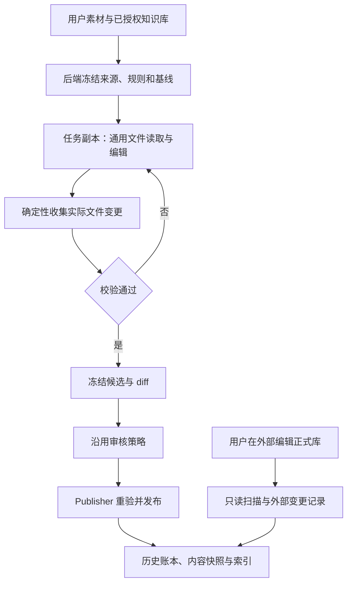

# 知识库文件驱动与后端治理方案

> 日期：2026-10-13  
> 状态：源码分析与改造建议，尚未实施；不修改现有发布权限或审核策略。  
> 范围：Wiki / 人脉 / Memory 等知识库的 Agent 操作面、候选生成、审计与版本管理。  
> 出发点：Agent 遵循知识库的 `AGENTS.md` 和 schema，用通用文件工具整理内容；后端负责校验、审核、发布和版本记录。

## 1. 结论与建议

建议把知识整理统一为**文件驱动的候选生成，后端治理的正式发布**。

Agent 看得见规则、来源和 Markdown，直接搜索、读取、编辑任务副本。后端根据实际文件字节生成候选，不要求 Agent 把全文再次编码进知识库专用工具的 JSON 参数，也不在提交工具内部开启另一轮隐藏的模型生成。

保留已有来源冻结、内容寻址对象库、PublicationBatch、审核账本、Publisher、发布日志、外部编辑同步和历史记录。收敛的是 Agent 的操作接口与重复的候选生成流程。

核心职责是：

| 层 | 职责 | 可验证的结果 |
| --- | --- | --- |
| `AGENTS.md` | 整理方法、来源纪律、查重、关系维护、不确定性处理 | Agent 的行为与生成内容是否符合任务要求 |
| `wiki.schema.json` | 实体、字段、目录、引用格式 | 确定性的结构校验结果 |
| Agent | 阅读、判断、组织、编辑知识 | 任务副本中的实际文件变更 |
| 执行宿主 | 授权库选择、来源范围、任务目录与工具访问范围 | 本次执行实际获准读写的范围 |
| 后端治理 | 冻结 diff、审核、冲突检测、发布、审计、版本恢复 | 已批准且与实际发布字节一致的回执 |

`AGENTS.md` 的行为约定、schema 的结构校验和运行时的访问控制互补。遵循规则是 Agent 的职责，但提示词不能替代文件访问权限，结构正确也不能自动证明事实正确。

## 2. 当前源码事实

以下为本次读取源码所得的静态结论，不代表真实模型质量、安装发行态或全部故障路径已经验收。

### 2.1 知识库正文与规则已是文件

- `KnowledgeBinding` 区分注册根、`contentRoot` 和 `linkRoot`，知识库独立于业务 Workspace 的 cwd。见 [contracts.ts](../apps/server/src/knowledge/contracts.ts)。
- 根目录 `AGENTS.md` 由 `readKnowledgeOperationContract()` 安全读取并计算哈希；整理任务冻结其内容，运行中重验是否变化。见 [operation-contract.ts](../apps/server/src/knowledge/operation-contract.ts) 和 [curator-jobs.ts](../apps/server/src/knowledge/curator-jobs.ts)。
- 根目录 `wiki.schema.json` 是结构声明的事实源；绑定中的 preset 信息记录来源。见 [schema-impact.ts](../apps/server/src/knowledge/schema-impact.ts)。
- schema 当前是 Teams 自有的实体、字段和关系声明，校验由 `validateTeamsNote()` 实现；不能将其未经验证地描述成通用 JSON Schema。见 [schema-presets.ts](../apps/server/src/knowledge/schema-presets.ts) 和 [note-validation.ts](../apps/server/src/knowledge/note-validation.ts)。
- 内容路径由 `schemaContentPrefix()` / `schemaEntityDirectory()` 解析，既有平铺结构，也有 `wiki/` 前缀结构。文件接口必须保持实际绑定的坐标系，不能统一硬编码 `wiki/`。见 [schema-layout.ts](../apps/server/src/knowledge/schema-layout.ts)。

当前已经使用文件规则，但主要由宿主读取后包装成模型上下文，不是完整的原生文件操作体验。

### 2.2 日常读取主要通过知识库专用工具

[runtime-service.ts](../apps/server/src/knowledge/runtime-service.ts) 的 `KnowledgeMountSurface` 向模型暴露：

- `knowledge_context`：已授权库和本轮挂载信息。
- `knowledge_search` / `knowledge_glob` / `knowledge_read`：检索、列目录、读取固定正文。
- `knowledge_links`：出链与反链。
- 可选业务工具，例如往来状态更新。

这些工具同时承担授权重验、读取预算、快照选择、来源引用和读取证据记录。不能只删工具而丢掉这些职责；应把通用访问职责转移到任务挂载和文件访问层，把检索优化保留为可选能力。

### 2.3 日常整理有当前 Worker 与后台生成两种执行方式

[curator-jobs.ts](../apps/server/src/knowledge/curator-jobs.ts) 的 `executionMode` 区分 `worker` 与 `background`：

1. **当前聊天 Wiki Worker**：`workerCurationSurface()` 注册 `knowledge_prepare_candidate` 和 `knowledge_submit_candidate`。准备工具冻结素材、基线与规则，当前 Worker 继续生成；提交工具接收 `pages[{path, content, reason}]` 并登记候选。它明确不启动后台 Agent。见 [worker-curation.ts](../apps/server/src/knowledge/worker-curation.ts)。
2. **后台整理**：`requestSurface()` 提供整理入口，后台 `generate()` 创建独立 Pi SDK Session，禁用原生工具与原生上下文文件发现，使用挂载工具及提交工具生成候选。任务有独立 Job 和状态反馈。见 [curator-jobs.ts](../apps/server/src/knowledge/curator-jobs.ts)。

受限 Wiki profile 在 [pi-driver.ts](../apps/server/src/agent-runtime/pi-driver.ts) 中也关闭原生上下文发现与原生工具，依赖宿主提供的工具和规则。

因此不能把现状笼统描述为“所有知识工具都偷偷开后台模型”。真正需要收敛的是：任务准备、规则输送、Markdown 全文提交和候选登记都耦合在专用工具协议中，Agent 除了知识规则还必须掌握平台工作流。

### 2.4 CompileJob 已有文件驱动的候选路径

当前系统并非完全缺少文件接口：

- [compile-source.ts](../apps/server/src/knowledge/compile-source.ts) 将指定采纳版本物化为冻结来源目录。
- [candidate.ts](../apps/server/src/knowledge/candidate.ts) 的 `composeCompileTask()` 要求 Worker 读取来源、将候选 `.md` 写到 cwd；`createCandidateValidator()` 在本 Job 的编译委托完成后扫描 staging，校验字节、来源、结构并冻结 PublicationBatch。
- [compile-jobs.ts](../apps/server/src/knowledge/compile-jobs.ts)、[compile-admission.ts](../apps/server/src/knowledge/compile-admission.ts) 与 Runtime 负责 Job 身份、委托绑定、执行准入和恢复。
- [wiki.ts](../apps/server/src/routes/wiki.ts) 的编译入口要求启用的本地 Codex spawn Connector，并核验包与执行文件身份；不是任意 Agent 的通用文件入口。

这条路径目前限制为 Markdown 编译，要求指定已采纳来源；不支持删除，也没有图片原件发布授权。它不能直接替代日常聊天、图片与附件整理。改造应复用其“宿主物化输入、Agent 写文件、后端扫描候选”的机制，再统一输出和治理链路。

### 2.5 后端治理是已有基础

| 能力 | 源码与事实 |
| --- | --- |
| 原始素材保真 | [chat-intake.ts](../apps/server/src/knowledge/chat-intake.ts) 关联真实入站消息、附件与来源 ID，不把 Manager 改写的委派文本当用户原话 |
| 候选验证 | `WikiCuratorService.submit()` 校验目录、来源范围、结构、基线和图片引用，再冻结内容；并非直接写正式库 |
| 固定审核 | [review-store.ts](../apps/server/src/knowledge/wiki/review-store.ts) 将决定绑定到 `batchId + revision + manifestHash` |
| 发布一致性 | [publisher-markdown.ts](../apps/server/src/knowledge/wiki/publisher-markdown.ts) 校验冻结决定、当前授权、目标与基线，按发布组执行并记录实际结果 |
| 规则变化检查 | [publication-context.ts](../apps/server/src/knowledge/wiki/publication-context.ts) 对比根身份、绑定、信任、schema 与 AGENTS 契约哈希 |
| 发布恢复 | [publish-journal.ts](../apps/server/src/knowledge/wiki/publish-journal.ts) 保存操作身份、逐文件回执、before image、发布组与中断状态 |
| 内容版本 | [objects.ts](../apps/server/src/knowledge/objects.ts) 保存内容寻址字节；[history-store.ts](../apps/server/src/knowledge/history-store.ts) 保存历史事件；[acceptance.ts](../apps/server/src/knowledge/acceptance.ts) 用 outbox 衔接采纳账本与历史投影 |
| 外部编辑 | [observation.ts](../apps/server/src/knowledge/observation.ts) 周期扫描并冻结外部变化，更新当前快照；隔离未完成发布的残留字节，不回写或撤销用户编辑 |

现有进程内按库串行化不能被当作跨进程锁；多文件发布组和中断日志也不能被描述成整个 Vault 的文件系统原子事务。新文件入口应保留这些真实边界。

## 3. 从第一性原理推导改造

### 3.1 知识内容的自然接口是文件

知识正文、索引、双链和操作规则本来就是可阅读的 Markdown / JSON。Agent 已擅长搜索、读取、编辑文件。把全文再组织成专用工具参数，只增加另一套协议、上下文占用和错误修复路径。

标准接口应由路径、格式、读写范围、提交边界和回执共同定义。仅把一个后台操作入口改成 JSON 文件，仍然没有解决透明性问题。

### 3.2 整理与发布是两个不同动作

整理会产生中间稿、失败稿与多次修订；发布表示已批准的确定内容成为正式知识。文件保存不能直接等于发布，模型回复“完成”也不能直接等于发布。

因此 Agent 的工作对象是任务副本；后端的发布对象是冻结候选。两者之间有显式、可检查的收集与校验边界。

### 3.3 规则不应复制成多个独立事实源

Agent 读取的 `AGENTS.md` 和 schema，应是本次任务冻结的真实规则；后端校验也使用同一代规则。目录规范、字段要求和来源格式不应分别写死在提示词、工具 description 和后端转换逻辑中。

宿主可以生成简短的路径映射和任务说明，但生成内容必须指向同一规则版本，不能形成可独立修改的第二份 schema。规则在执行或审核期间变化，应产生明确的失效/重验状态，而非静默切换。

### 3.4 审计要基于实际字节和可信来源

Agent 填写的修改理由有价值，但不足以证明执行者、素材来源、修改集合或发布成功。后端应从授权快照、访问记录、文件 diff 和发布回执形成审计。

“已读取某条来源”也不证明该来源支持全部结论。后端确定性检查结构与引用范围；事实取舍、推断质量和不确定性仍由 Agent 与审核承担。

### 3.5 少工具与少用户介入分别设计

常规读取、任务准备、结构校验、修正和幂等重试由平台与 Agent 自行完成。首版沿用现有正式库审核策略，一次审核冻结批次，不为每次文件写入另建批准卡。

发布失败、基线变化和规则更新优先给出可执行诊断；只有无法保持用户约束的真实取舍才请求用户。是否允许预授权自动发布属于独立策略，不由本次文件接口改造隐式放开。

## 4. 目标架构



### 4.1 任务目录与路径约定

以下是目标布局示例，不是当前落盘结构，也不要求真实知识库改名或搬迁：

```text
<task-root>/
  AGENTS.md             # 冻结规则，只读
  wiki.schema.json      # 冻结结构，只读
  task.md               # 本次整理要求、库映射、来源说明，只读
  sources/              # 获准原始素材及提取结果，只读
  library/              # 当前授权库的副本，允许编辑候选
    <实际相对路径>       # 保留当前 contentRoot 下的路径及双链坐标系
```

宿主私有 Job、baseline、来源映射、对象库与审核回执位于任务目录之外，Agent 不可修改。`task.md` 可展示只读身份信息，但不能让 Agent 通过修改文件选择 owner、bindingId 或发布目标。

- 文件映射由后台根据已授权 `bindingId` 生成，知识库选择不由 Agent 自由拼接宿主绝对路径。
- `library/` 只是任务访问前缀；收集时去掉此前缀，保留绑定的真实相对路径。Markdown 双链不写入临时前缀。
- 普通任务不能修改规则、schema、原始来源或宿主记录；修改知识库契约属于独立管理操作。
- 未配置 schema 的既有库明确标为无结构声明，按通用 Markdown 规则处理；不偷偷添加实体结构。任务中展示的规则应区分真实库契约与宿主访问说明。
- 多库读取用稳定别名区分；首版一次写入一个目标库，避免隐式跨库事务。
- 小库可以完整物化副本。大库首版应设明确大小/数量上限；后续可按需物化已授权文件，记录每次提供的版本。不能静默截断目录并把缺失文件认成删除。

### 4.2 通用工具与执行边界

Agent 使用 `read / ls / find / grep / write / edit` 等通用文件语义。首版采用限定任务目录的实现：规则和 sources 只能读，library 可写；对真实路径、链接与目录身份进行检查，不把任意宿主路径作为文件接口的一部分。

这些访问限制属于通用文件能力的范围配置，不应再产生 `knowledge_read_person`、`knowledge_edit_memory`、`knowledge_create_note` 等业务工具家族。

仅修改 cwd、复制目录或设置普通文件权限不足以限制同一用户进程的全部访问。若提供 bash、可执行扩展或任意外部 Connector，必须有宿主实际支持的隔离边界；否则首版保持受限文件工具，不声称具备 OS 沙箱保障。

行为规则在任务根显式加载，避免业务 Workspace 的 `AGENTS.md` 被意外发现并混入知识契约。不能直接把当前 `noContextFiles` 改为全量自动发现后就宣布完成。

### 4.3 提交：首版保留一个薄检查点

首版建议保留一个“校验并提交当前任务文件”的薄工具，后端从已绑定任务目录收集字节。它不接受 Markdown 全文、任意发布路径、owner 或新 bindingId，也不发起新的模型调用。

工具只返回以下确定性信息：

- 成功：jobId、batchId、候选哈希、变更摘要、审核入口，或 no_changes。
- 可修复错误：相对文件、字段/行号、错误类型、实际值与期望格式。
- 不可继续：取消、授权撤回、规则/基线失效及恢复入口。

Agent 在同一任务修正后再次提交。后台按任务身份与候选哈希幂等处理；模型说“完成”不能跳过校验。后续只有在统一 Run 终态能可靠表达候选完成边界后，才考虑去掉这个检查点。

收集时必须停止候选写入、取得稳定文件视图并冻结对象；不能根据一次文件变更事件立刻登记整批，更不能审核时仍读取可修改的 staging。提交后继续编辑应产生新的候选代际，使旧审核不能批准新字节。

### 4.4 来源与读取证据

复用 `ChatKnowledgeIntake` 和 `KnowledgeSourceStore`：先冻结获准原话及附件，再物化到 sources。派活文本是整理指令，不替代用户原话；相对日期使用任务冻结的来源时点，恢复时不重新解释。

文件访问层记录已提供的相对路径、内容哈希及实际读取范围，接替 `KnowledgeMountSurface` 的来源和读取证据职责。不能为了方便而取消来源集合校验，也不能把 Agent 声称“已读”的文本当作宿主证据。

图片原件、提取文本与模型推断分别保存。视觉/OCR/PDF 提取若需要额外模型，应是可见的素材处理阶段，保留处理器、来源哈希、输出与告警；不能隐藏在提交动作里。已经冻结的素材处理结果不应在每次候选提交时重新生成。

### 4.5 候选与发布

通用收集器将文件变更转换成现有 PublicationBatch，重用审核与 Publisher：

1. 比较固定 baseline 与稳定的候选文件集。
2. 校验目录、schema、身份、来源引用、图片及大小/格式限制。
3. 将候选字节放进对象库，保存规则哈希、修改说明和来源关系。
4. 冻结 diff 与 manifestHash，登记审核。
5. 审核通过后重验目标内容、授权和规则，发布冻结对象中的字节。
6. 记录逐文件/发布组回执；成功后更新当前快照与历史。

首版保持 create/update 语义。任务副本丢失、未物化或被误删文件不自动产生正式库删除；删除与重命名需要独立的明确操作契约和审核展示。新增入口不能通过更改规则文件自行扩大允许操作范围。

### 4.6 角色与宿主边界

知识文件协议不绑定某一个模型供应商。首期先在受控 Wiki Pi Worker 落地，再让其他受支持 Connector 复用文件任务与候选收集器。

普通业务 Worker 仍只读取已授权知识，按当前规则请求默认 Memory 更新；文件接口改造不自动赋予所有 Worker 全库写权限。Manager 负责路由和任务协调，生成工作由实际执行 Worker 完成。

完整授权、审核、发布、恢复和窗口闭环属于 PuddingTeams。若将文件协议或收集核心包装为独立能力包，共享核心不依赖宿主；pi 适配只使用 ExtensionAPI，Driver 适配只使用 Driver SPI。不能把 Teams 的治理状态机塞进 Connector。

## 5. 工具与模块收敛

| 当前入口/能力 | 目标安排 |
| --- | --- |
| `knowledge_prepare_candidate` | 准备、冻结和物化由宿主完成；任务恢复沿用原 Job 和来源。模型需要澄清目标时才选择库，避免多次准备调用 |
| `knowledge_submit_candidate(pages)` | 替换成绑定当前任务的薄提交检查点；后端读取文件，不重复传全文 |
| `knowledge_context` | 挂载列表、规则位置和任务状态可在任务启动时提供；状态查询继续面向宿主事实 |
| `knowledge_glob/read` | 文件目录和读取能力；授权、预算、版本及读取证据移到访问层 |
| `knowledge_search/links` | 可选检索/关系加速。提供可核对的路径与版本，普通库不强制依赖 |
| `knowledge_request_curation` | 作为明确的任务启动入口按需保留，不作为文件 CRUD；开始生成时明确当前 Worker 或后台任务身份 |
| `memory_request_update` 等业务入口 | 保留必要的跨角色请求语义，后端路由到同一候选体系，不另造 Memory 发布流程 |
| 图片与附件提取 | 保留来源处理，展示实际处理阶段及额外模型调用；与提交动作分离 |
| schema/AGENTS 管理 | 独立管理入口与版本检查；普通内容整理不修改它们 |
| CompileJob 文件编译 | 复用文件扫描、来源冻结及执行治理，逐步统一候选验证和回执，保留 Connector 特有准入 |

“少工具”不要求删除每一个有明确用途的能力。判断标准是能否用现成文件操作表达、是否有隐藏生成行为、是否重复维护同一知识规则，以及用户能否查看实际结果。

## 6. 审计、版本管理与 Git 的位置

### 6.1 内容与控制记录分别保存

- **正式 Markdown / 规则文件**：用户可阅读和外部编辑的内容。
- **内容对象**：按哈希保存不可变字节，支撑固定 diff、证据读取与恢复。
- **控制账本**：授权、Job、来源关联、候选、审核决定、发布组、失败/恢复状态。
- **索引与图谱**：从已生效内容派生，可重建，不能成为正文唯一事实源。

不应强行把全部控制记录变成 Agent 可写 Markdown。内容开放可编辑与平台治理可靠可以同时成立。

### 6.2 最小审计记录

建议统一记录任务与执行身份、目标库与修订、规则/schema 哈希、来源快照、读取证据、每个文件的 baseline/candidate 哈希、修改原因、审核决定、发布回执及外部变化渠道。Agent 的理由是补充说明；操作者、哈希与时间由宿主生成。

版本恢复应形成有基线检查的新变更批次，保留恢复前后记录。现有 Publisher 的失败回滚是发布恢复能力，不能直接等同于已经具备用户可操作的任意版本恢复产品入口。

### 6.3 Git 是可选版本出口

可以借鉴 Git diff、版本历史和审阅，但首版继续使用现有对象库、审核账本和发布日志。若后续接入 Git，应由后端管理独立的版本目录与写入序列，不自动提交用户业务 Workspace，也不依赖 Agent 自己 commit/push 来证明发布成功。

完整 GitOps 包含声明式期望状态、不可变版本记录、自动拉取与持续协调；当前方案主要借鉴文件接口、版本化候选和受控发布，不以完整 GitOps 为首版验收要求。[OpenGitOps 原则](https://opengitops.dev/)

文件接口本身也应有版本与完成回执。CMake 的 File API 通过约定查询文件和结果文件交互，说明文件可以成为正式接口，但仍需要确定的消费、处理和反馈规则。[CMake File API](https://cmake.org/cmake/help/latest/manual/cmake-file-api.7.html)

## 7. 典型场景与恢复行为

| 场景 | 预期处理 | 用户介入 |
| --- | --- | --- |
| 只查知识 | 挂载授权快照，读取文件/可选索引，不创建整理候选 | 无额外准入 |
| 整理一条人脉记录 | 冻结原话，查重，修改候选文件，自动校验 | 一次批次审核 |
| schema 字段错误 | 返回文件/字段诊断，当前 Worker 修正同一任务 | 无重复批准 |
| 确实没有变更 | 后端比较字节返回 no_changes，不虚构审核批次 | 无 |
| 审核期间用户在 Obsidian 编辑同一笔记 | 同步外部新版本；旧候选发布前基线检查冲突，保留双方字节 | 必要时决定如何合并 |
| 用户编辑另一笔记 | 未涉及文件不应仅因全库快照修订而无条件阻塞；仍检查依赖、规则与授权 | 通常无 |
| AGENTS/schema 改变 | 旧任务/候选明确失效或重验；展示具体变化，不静默使用新规则 | 只有实质取舍才询问 |
| 授权撤回 | 停止继续读取/生成，保留已冻结的审计，不发布 | 不请求无效放行 |
| 生成时服务重启 | 保留任务、来源和基线；按明确恢复规则继续，不把“继续”当新事实素材 | 可从原任务续作 |
| 候选固定后审核登记失败 | 从冻结对象重试登记，不重新调用模型 | 无 |
| 发布中断 | 依发布日志对账实际字节和发布组，未完成残留不作为外部正常编辑采纳 | 不明确的效果才升级处理 |
| Agent 误删任务文件 | 不转换成正式删除，不以“没有文件”证明完成 | 通常无 |

上述为目标行为。是否已经具备对应的自动恢复入口，需按源码和阶段验收分别确认。

## 8. 实施顺序与验收

### 第一阶段：通用任务目录和受限文件能力

复用冻结素材和规则，建立 taskRoot、library 映射、baseline 与绑定身份；提供通用文件操作，接替原挂载工具的授权/预算/读取证据职责。首期仅 Wiki Pi Worker、单目标库、Markdown create/update。

退出条件：同一素材和规则能在可阅读文件中检查；越界读写、规则修改与来源修改被拒绝；业务 Workspace 不影响知识库规则；实际路径与双链坐标一致。

### 第二阶段：候选收集与统一发布

薄提交工具扫描文件；将现有 `submit(pages)` 的结构、来源、图片和基线验证拆为可复用后端组件；接入现有 PublicationBatch、审核页面与 Publisher。CompileJob 复用同一候选契约，保留自身来源和 Connector 限制。

退出条件：模型参数不再携带全文；审核 diff 与发布字节哈希一致；同一候选重试无额外模型调用或重复登记；外部修改被检测，不被覆盖。

### 第三阶段：附件、退回修订和完整聊天旅程

覆盖图片/PDF/网页素材、原件引用、当前 Worker 续聊、退回修订、取消、服务重启、Memory 请求、执行过程和结果通知。不能以 Markdown 原型替代原有素材范围。

退出条件：真实 SDK/Connector 与浏览器旅程验证完整闭环，原话和来源时点保留，失败有实际状态和可恢复入口；受审候选不受后续 staging 编辑影响。

### 第四阶段：可选检索与 Git 版本出口

在文件主路径成立后，再按库规模加入索引搜索、关系查询、按需物化和可选 Git 导出。先验证收益，不把这些能力变成每个 Agent 必须掌握的操作前提。

### 必测边界

1. 正常 create/update、无变化、未知字段保留、结构错误修复。
2. 中文/大小写/Unicode 路径冲突、软硬链接、路径逃逸、过大文件、来源伪造。
3. 规则/schema/授权在生成中与审核后变化。
4. 审核后替换候选文件，旧决定不能批准新字节。
5. 外部同时编辑、发布失败、中断恢复、历史归因和未完成残留隔离。
6. 取消、超时、服务重启、重复提交，不把部分稿登记为完成候选。
7. 每次真实模型调用和执行者可见，文件提交与登记不额外启动模型。
8. 同一任务修正不重复请求准入；批次审核与原生 Worker 权限交互不混淆。

本阶段文档只确定建议与验收边界，没有执行这些新架构测试。实施时同步通用 Agent 接入方案、提示词体系与会话记录规范；若修改 session customType/结构，再更新 JSONL 消费契约。

## 9. 首版取舍与待明确项

建议首版固定：单目标库、受限通用文件工具、显式薄提交、create/update、沿用批次审核、保留现有后端版本体系、不依赖 Git。

实施前需要通过实际库规模和 SDK 适配验证的事项：完整副本的容量阈值、文件工具的限制接口、来源读取证据精度、取消后恢复的任务代际、附件物化形式，以及索引与日志由 Agent 提出还是由后端确定性派生。`wiki/log.md` 是可阅读的知识整理日志，后台审计账本仍是实际操作的权威记录。

删除/重命名、schema 与操作契约修改、跨库写入、预授权自动发布、开放 bash 和 Git 写入均为独立扩展，不混入首版以扩大授权范围。

## 10. 相关资料

- 讨论来源：[解释 file as API 与 GitOps](codex://threads/01a132cf-86fe-7a91-8125-a0bf61d61595)。该讨论用于设计动机，当前行为以本次源码核对为准。
- [通用 Agent 接入方案](./2026-08-06-通用-agent-接入-底层与扩展方案.md)：Runtime / Driver / Extension 边界。
- [房间即群聊产品模型](./2026-08-05-房间即群聊-产品模型方案.md)：Manager / Worker 与交接。
- [会话记录格式与 Harness 消费](./2026-08-14-会话记录格式与Harness消费.md)：过程和结果投影。
- [提示词体系完整介绍](./2026-08-17-提示词体系完整介绍.md)：规则加载与上下文。
